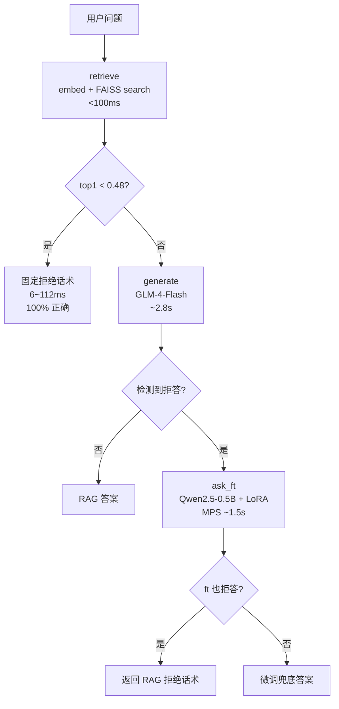
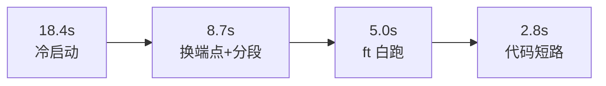

# 星辰科技客服机器人

> 一个从 API 调用到生产部署的完整大模型应用实战项目。
> 用 8 个关卡逐层叠加技能，每一层都有可运行脚本、评测数据和踩坑记录。

[](https://python.org)
[](https://fastapi.tiangolo.com)
[](https://huggingface.co)
[](LICENSE)

---

## 一句话概括

**RAG 优先 + 微调兜底 + 代码级相似度短路**的客服系统：
- 知识性问题走 RAG，2.8s 答对
- 库外问题走代码短路，**6ms 正确拒绝**
- 库内主题但无条款时回退微调，4.5s 兜底
- 风格 100% 统一，5 并发 0 失败

---

## 目录

- [系统架构](#系统架构)
- [核心数据](#核心数据)
- [快速开始](#快速开始)
- [八关技能地图](#八关技能地图)
- [关键工程决策](#关键工程决策)
- [踩坑清单](#踩坑清单)
- [性能画像](#性能画像)
- [评测体系](#评测体系)
- [技术栈](#技术栈)
- [项目结构](#项目结构)
- [后续方向](#后续方向)

---

## 系统架构



### 消息流示例

**知识性问题（RAG 路径）**
```
用户: 公司年假有几天？
→ retrieve top1=0.72
→ GLM-4-Flash 基于员工手册生成
→ 2.8s 返回: 满一年 15 天，满五年 20 天
```

**库外问题（短路路径）**
```
用户: 厦门天气怎么样？
→ retrieve top1=0.26 < 0.48
→ 代码直接返回固定拒绝话术
→ 8ms 返回: 该问题暂不在我的知识范围内
```

**库内主题无条款（兜底路径）**
```
用户: 公司婚假有几天？
→ retrieve top1=0.60
→ GLM-4-Flash 说"资料未提及"
→ 回退 ask_ft（微调模型记得婚假 10 天）
→ 4.5s 返回: 员工结婚可享受 10 天婚假
```

---

## 核心数据

| 指标 | 数值 | 说明 |
|---|---|---|
| **风格一致性** | **100%** | 5 组评测全部守住客服模板 |
| **拒绝准确率** | **100%** | 训练集内外均正确拒绝 |
| **组 A（知识）** | 纯微调 40% → 纯 RAG 50% → **组合 70%** | 失败模式不重叠 |
| **拒绝路径延迟** | **6~112ms** | 代码短路，不调 LLM |
| **RAG 路径延迟** | 2.8s（P50） / 5.3s（P99@5并发） | 远程 API 瓶颈 |
| **兜底路径延迟** | 4.5s（单）/ 9.4s（P99@5并发） | `ft_lock` 串行化 |
| **5 并发吞吐** | RAG 1.70 req/s / 兜底 0.50 req/s | 0 失败 |
| **优化幅度** | 18s → 8.7s → **2.8s** | 每一步都有数据支撑 |

---

## 快速开始

### 环境准备

```bash
# 克隆项目
git clone <your-repo>
cd customer-service-bot

# 安装依赖
pip install -r requirements.txt

# 设置环境变量
export ZCODE_API_KEY="你的智谱API Key"
```

### `requirements.txt`

```
openai>=1.0.0
fastapi>=0.100.0
uvicorn>=0.23.0
sentence-transformers>=2.2.0
faiss-cpu>=1.7.0
transformers>=5.20.0
peft>=0.21.0
datasets>=2.14.0
torch>=2.1.0
pydantic>=2.0.0
```

### 启动服务

```bash
# 1. 建知识库（把 txt 文档放入 docs/）
# 2. 训练微调模型（见第六关脚本）
python3 6make_data5.py
python3 6finetune_lora5.py

# 3. 启动服务
uvicorn 8serve:app --host 0.0.0.0 --port 8000
```

### 测试

```bash
# 健康检查
curl http://localhost:8000/health

# 知识性问题（走 RAG）
curl -X POST http://localhost:8000/chat \
  -H "Content-Type: application/json" \
  -d '{"question":"公司年假有几天？"}'
# → {"answer":"...15 天...","path":"rag","elapsed_ms":2800}

# 库外问题（走短路）
curl -X POST http://localhost:8000/chat \
  -H "Content-Type: application/json" \
  -d '{"question":"厦门天气怎么样？"}'
# → {"answer":"...暂不在我的知识范围...","path":"rag(拒绝·低相似)","elapsed_ms":8}
```

### 跑评测

```bash
python3 7eval_v2.py   # 三方案对照：纯微调 / 纯RAG / RAG优先
```

---

## 八关技能地图

| 关卡 | 技能 | 核心产出 | 关键数据 |
|---|---|---|---|
| **1** | API 调用 | 打通模型接口 | temperature 0.1 vs 0.9 对比 |
| **2** | Prompt 工程 | 结构化 JSON 输出 | 裸 Prompt 0/5 → Few-shot 5/5 合法 |
| **3** | RAG + 向量库 | 私有知识注入 | 无 RAG 编造 → RAG 引用条款 |
| **4** | Agent | 工具调用循环 | 并行 tool_calls，2 轮完成 |
| **5** | 工作流编排 | 节点契约 + 多标签路由 | 扇出矛盾 → 三种解法组合 |
| **6** | 微调 | 风格 + 拒绝策略固化 | 训练集内外格式 3/3 守住 |
| **7** | 评测 | 五组测试集 + 组件拆解 | 40% / 50% / **70%** |
| **8** | 部署 | FastAPI + 性能优化 | **18s → 2.8s** |

---

## 关键工程决策

### 决策 1：微调 + RAG 组合，不是二选一

| 方案 | 组 A（知识） | 组 C（拒绝） |
|---|---|---|
| 纯微调 | 40% | 100% |
| 纯 RAG | 50% | 100% |
| **组合** | **70%** | **100%** |

**失败模式不重叠**：
- RAG 救微调的串扰（报销截止、大额审批、每周远程）
- 微调救 RAG 的覆盖空白（婚假、停车位）

> 微调管"怎么说"，RAG 管"说什么"，代码短路管"该不该答"。

### 决策 2：拒绝用代码保证，不用模型保证

| 方案 | 天气问题 | 延迟 |
|---|---|---|
| 靠 prompt 让 LLM 拒绝 | ❌ 讲了天气 | 2.5~3.5s |
| **`top1 < 0.48` 代码短路** | ✅ 正确拒绝 | **6ms** |

> 正确性必须用确定性的代码保证，不能用概率性的模型保证。

### 决策 3：兜底顺序是 RAG 优先

```
❌ 错误架构：微调拒答 → RAG 兜底
   问题：微调答错时自信地编，不含拒答词，兜底不触发

✅ 正确架构：RAG 优先 + 微调兜底
   原因：RAG 的错误（检索不到→拒绝）可检测，
        微调的错误（自信地编）不可检测
```

### 决策 4：评测分组，暴露结构性缺陷

不分题型只看"组 B 67%"，看不到"是非题 100%、程序题 0%"。
**平均值会掩盖结构性问题。**

---

## 踩坑清单

| # | 坑 | 现象 | 修复 |
|---|---|---|---|
| 1 | Few-shot 内容粒度漂移 | "科幻小说"→"科幻"、"第二版"丢失 | 检查信息完整性 |
| 2 | RAG 接地性过强 | 满三年年假答"不知道" | 区分"直接陈述"和"合理推断" |
| 3 | 建库占位代码 | 各文件贡献 0 片段却共 4 个 | 每文件贡献日志，校验和=总数 |
| 4 | 扇出矛盾 | "不知道天气"+"多云26°C" | 拆分/职责限定/merge 组合 |
| 5 | **peft + transformers 5.x 静默失效** | `PeftModel` 后 generate 走纯 base | `merge_and_unload()` |
| 6 | base 被原地污染 | "微调前/后"逐字相同 | 先跑完 base 存答案 |
| 7 | 训练量不足 | 6 步训练输出无变化 | loss < 1.0，lora_B 长到 1e-3 |
| 8 | 拒绝样本只按主题覆盖 | 程序题拒绝率 0% | 按"问题类型 × 主题"二维覆盖 |
| 9 | 兜底触发器依赖模型自我认知 | 答错时自信地编，兜底不触发 | 改成 RAG 优先 |
| 10 | **`glm-5.3-flash` 强制思考** | `reasoning_tokens` 占 71%，17s | 换 `glm-4-flash` |
| 11 | coding plan 端点长 prompt 慢 | 3.93s vs 通用端点 1.5~2.5s | 换 `/paas/v4` |
| 12 | MPS 默认没用上 | ft 3.09s（CPU） | `.to("mps")` + 输入也搬 |
| 13 | prompt 约束 LLM 拒绝不可靠 | 天气、笑话照样答 | 代码短路 `top1 < 0.48` |

### 坑 5 详解：peft 5.x 静默失效

```python
# ❌ 错误写法（transformers 5.20 + peft 0.21）
ft = PeftModel.from_pretrained(base, "lora_out")
ft.generate()   # 走纯 base 路径，LoRA 层没注入

# 诊断证据：
# - ft 内部 q_proj 类型: Linear（应该是 LoraLayer）
# - logits 最大差异: 0.0

# ✅ 正确写法
merged = PeftModel.from_pretrained(base, "lora_out").merge_and_unload()
```

### 坑 10 详解：GLM-5.3-Flash 强制思考

```json
"completion_tokens": 145,
"completion_tokens_details": {
    "reasoning_tokens": 103      // ← 71% 是思考
}
```

- `thinking.type = "disabled"` **无效**
- `thinking.type = "enabled"` + `reasoning_effort = "low"` 只能从"深度"降到"轻量"，**不能归零**
- 客服场景应换 `glm-4-flash`（非强制思考）

---

## 性能画像

### 优化曲线：18s → 2.8s



| 优化项 | 操作 | 效果 |
|---|---|---|
| 冷启动识别 | 连续 5 次 curl | 18.4s → 4.3s（单调收敛） |
| 换通用端点 | `/coding/paas` → `/paas` | 长请求 3.93s → 1.5~2.5s |
| **代码短路** | `top1 < 0.48` 直接拒 | **2.5s+幻觉 → 6ms+100%正确** |
| ft 限长 | `max_new_tokens` 200→80 | 自然结束，35 token |
| **MPS 加速** | `.to("mps")` | ft 3.09s → ~1.5s |

### 单请求延迟

| 路径 | 延迟 | 占比（预估） |
|---|---|---|
| `rag(拒绝·低相似)` | **6~112ms** | 20~30% |
| `rag` | **2.8s** | 50~60% |
| `rag→ft` | **4.5s** | 10~20% |

### 压测结果（`ab` 工具，5 并发）

| 路径 | 吞吐 | P50 | P99 | 失败 |
|---|---|---|---|---|
| `rag`（年假） | **1.70 req/s** | 2273ms | 5329ms | 0 |
| `rag→ft`（婚假） | **0.50 req/s** | 5086ms | 9360ms | 0 |

**关键结论**：
- RAG 路径接近线性扩展，瓶颈在远程 LLM 配额
- 兜底路径吞吐掉 3.4 倍，`ft_lock` 串行化是主因
- **MPS 优化的是单请求延迟，不是吞吐**

### 三个已知上限

1. RAG 路径 P99 受远程 LLM 抖动影响（5.3s@5并发）
2. 兜底路径吞吐受 `ft_lock` 限制（0.50 req/s@5并发）
3. 冷启动约 8~15s，靠 `/health` 503 挡流量

---

## 评测体系

### 五组测试集（34 条）

| 组别 | 内容 | 条数 | 通过标准 |
|---|---|---|---|
| A | 训练集内精确（测记忆） | 10 | 关键词匹配 |
| B1 | 是非题改写（测泛化） | 6 | 必须拒绝 |
| B2 | 定义题改写（测泛化） | 6 | 必须拒绝 |
| B3 | 程序题改写（测核心短板） | 6 | 必须拒绝 |
| C | 训练集外新主题（测边界） | 6 | 必须拒绝 |

### 三方案对照结果

| 方案 | 组 A | 组 B1 | 组 B2 | 组 B3 | 组 C |
|---|---|---|---|---|---|
| 纯微调 | 40% | 100% | 83% | 100% | 100% |
| 纯 RAG | 50% | — | — | — | 100% |
| **RAG 优先** | **70%** | — | — | — | **100%** |

### 逐条路径归因（组 A）

| 问题 | 纯微调 | 纯RAG | 组合 | 路径 | 说明 |
|---|---|---|---|---|---|
| 年假 | ✅ | ✅ | ✅ | rag | RAG 直接答对 |
| 报销截止 | ❌ | ✅ | ✅ | rag | **RAG 救微调串扰** |
| 试用期远程 | ✅ | ✅ | ✅ | rag | RAG 直接答对 |
| 大额审批 | ❌ | ✅ | ✅ | rag | **RAG 救微调串扰** |
| 每周远程 | ❌ | ✅ | ✅ | rag | **RAG 救微调串扰** |
| 婚假 | ✅ | ❌ | ✅ | rag→ft | **微调救 RAG 空白** |
| 加班费 | ❌ | ❌ | ❌ | rag→ft | docs 缺失 |
| 离职 | ❌ | ❌ | ❌ | rag→ft | docs 缺失 |
| 公积金 | ❌ | ❌ | ❌ | rag→ft | docs 缺失 |
| 停车位 | ✅ | ❌ | ✅ | rag→ft | **微调救 RAG 空白** |

**3 条失败全部指向"docs 缺主题"，不是架构问题。**

---

## 技术栈

| 组件 | 选型 | 说明 |
|---|---|---|
| 远程 LLM | **GLM-4-Flash**（通用端点） | 非强制思考，客服场景更合适 |
| 本地微调模型 | **Qwen2.5-0.5B-Instruct + LoRA** | 风格 + 拒绝策略 |
| 嵌入模型 | **BAAI/bge-small-zh-v1.5** | 中文检索，95MB |
| 向量库 | **FAISS (IndexFlatIP)** | 归一化后内积 = 余弦相似度 |
| 微调框架 | transformers 5.20 + peft 0.21 + datasets | 注意静默失效坑 |
| 服务框架 | **FastAPI + uvicorn** | 异步 + Pydantic 校验 |
| 硬件 | Mac (Apple Silicon, MPS) | ft 加速 2 倍 |

---

## 项目结构

```
customer-service-bot/
├── docs/                          # 知识库文档
│   ├── employee_handbook.txt      # 员工手册（年假/报销/远程）
│   ├── java.txt                   # 其他文档
│   └── yooasset_faq.txt
├── train.json                     # 55 条微调数据
├── lora_out/                      # 微调 adapter（v2）
├── lora_out_v1/                   # 微调 adapter（v1，对比用）
│
├── 1api.py                        # 第一关：API 调用
├── 2extractor.py                  # 第二关：结构化输出
├── 3rag_demo.py                   # 第三关：RAG + FAISS
├── 4agent_demo.py                 # 第四关：Agent 工具调用
├── 5work_flow.py                  # 第五关：工作流编排
│
├── 6make_data5.py                 # 第六关：生成训练数据
├── 6finetune_lora5.py             # 第六关：LoRA 微调
├── 6compare5.py                   # 第六关：微调前后对比
│
├── 7eval.py                       # 第七关：五组评测
├── 7eval_rag_fallback.py          # 第七关：RAG 兜底评测
├── 7eval_v2.py                    # 第七关：三方案对照
│
├── 8serve.py                      # 第八关：FastAPI 服务
├── eval_v2.json                   # 评测明细
├── eval_badcases.json             # bad case 导出
│
├── requirements.txt
└── README.md
```

---

## 后续方向

### 短期（1~2 天）

- [ ] **补充 `docs/` 三章内容**：加班费、离职、公积金 → 组 A 从 70% 提升到 90%+
- [ ] **加语义缓存**：相同/相似问题直接命中，RAG 路径 P50 降到毫秒级
- [ ] **启动预热**：`lifespan` 里先发一个假请求，消除冷启动

### 中期（1~2 周）

- [ ] **评测接 CI**：每次改 prompt/数据自动跑 `7eval_v2.py`，防止回归
- [ ] **流式输出**：`/chat` 改 SSE，用户感知延迟从 2.8s → 0.5s
- [ ] **Top-K 3→2 + 相似度过滤**：prompt 495 → 350 token，再省 0.3s

### 长期（1~2 月）

- [ ] **vLLM 部署**：替换 `transformers.generate`，支持 continuous batching，兜底路径吞吐提升 5~10 倍
- [ ] **多进程微调模型**：去掉 `ft_lock`，解决并发串行化
- [ ] **A/B 测试框架**：同一个问题路由到不同模型/参数，在线对比

---

## 面试可讲的三个故事

### 故事 1：我用 41 条数据微调 0.5B，验证了微调只能固化风格

> "我用 41 条数据微调 Qwen2.5-0.5B，训练集内 4 条全守格式，训练集外 3 条也守格式（风格泛化成功），但训练集外内容全部幻觉（知识注入失败）。这证明微调管'怎么说'、RAG 管'说什么'。我还踩到了 peft 0.21 + transformers 5.20 的集成断层：`PeftModel.from_pretrained` 后直接 generate 是静默失效的，必须 `merge_and_unload`。"

### 故事 2：从 18 秒到 2.8 秒的归因过程

> "部署后发现单请求 18 秒。连续 5 次 curl 发现是冷启动（18→4.3s）。分段计时发现 3.88s 是 ft 白跑——结果被丢弃了。裸测发现 GLM-5.3-Flash 是推理模型，reasoning_tokens 占 71%。换 GLM-4-Flash + 通用端点后降到 8.7s。最后用 'top1 < 0.48 代码短路' 把安全路径从 2.5s+幻觉降到 6ms+100%正确。"

### 故事 3：三方案对照证明组合优于单组件

> "我做了三方案对照评测：纯微调 40%、纯 RAG 50%、RAG 优先 70%，组 C 拒绝率三者都 100%。组合比单组件最高值多 20 个百分点，因为失败模式不重叠——RAG 救微调的 3 条串扰，微调救 RAG 的 2 条覆盖空白。剩余 3 条失败全部是 docs 缺失主题，精确指向'补文档'这个下一步。"

---

## License

MIT

---

**Star ⭐ this repo if it helps you!**